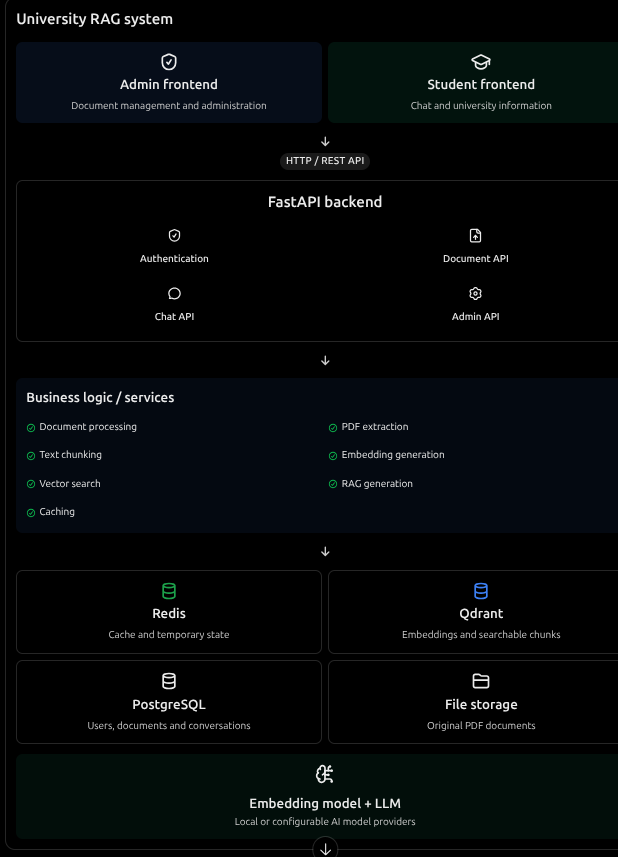

# icog_rag
An AI-powered knowledge assistant for ICog that uses Retrieval-Augmented Generation (RAG) to answer questions from the attached ICog document library. Built with React, FastAPI, Gemini, Redis, and Qdrant.

# Caching Strategies: Summary

## 1. Read Strategies

| | Cache-Aside (Lazy Loading) | Read-Through |
|---|---|---|
| Who loads data on a miss? | The **application** checks the cache, queries the DB on a miss, then fills the cache | The **cache layer/library** loads from the DB itself |
| App complexity | Higher (app owns the logic) | Lower (app only talks to the cache) |
| First request | Slow (miss, then DB) | Slow (miss, then DB) |
| Flexibility | High: any data shape or key | Lower: needs a loader configured in the cache |
| Failure behavior | App still works if the cache is down (falls back to DB) | Cache is a hard dependency |

## 2. Write Strategies

| Strategy | How it works | Pros | Cons |
|---|---|---|---|
| **Write-through** | Write to cache and DB synchronously | Cache always consistent with DB | Higher write latency |
| **Write-behind / write-back** | Write to cache, DB is updated asynchronously later | Very fast writes, batching possible | Data loss if cache fails before flush; eventual consistency |
| **Write-around** | Write only to DB, skip the cache | Avoids filling the cache with rarely read data | Next read is a miss; stale cache entry unless invalidated |

## 3. TTL, Invalidation, Eviction

- **TTL (Time To Live):** each key expires automatically after a set time. It is a simple safety net that bounds staleness.
- **Invalidation:** explicitly removing or updating a cached entry when the source data changes. It is accurate but easy to get wrong ("one of the hard problems in computer science").
- **Eviction:** the cache removes entries **when memory is full**, even if they are still valid and not expired. It is about capacity, not freshness.

## 4. Eviction Policies

| Policy | Removes | Best for | Weakness |
|---|---|---|---|
| **LRU** | Least recently used | General workloads with temporal locality | A one-time scan can flush hot data |
| **LFU** | Least frequently used | Stable "hot set" of popular items | Old popular items linger; slow to adapt |
| **FIFO** | Oldest inserted | Simplicity | Ignores usage, so it may evict hot data |
| **Random** | A random key | Very cheap, uniform access patterns | Unpredictable hit rate |

## 5. Redis Eviction Support

Configured with `maxmemory` and `maxmemory-policy`:

- `noeviction`: returns errors on writes when memory is full (default)
- `allkeys-lru`, `allkeys-lfu`, `allkeys-random`: consider all keys
- `volatile-lru`, `volatile-lfu`, `volatile-random`: consider only keys with a TTL
- `volatile-ttl`: evicts keys with the shortest remaining TTL first

**Redis supports LRU, LFU, and random, but not FIFO.** Its LRU and LFU are approximated (sampling-based) for speed, not exact.

## 6. Trade-offs and Our Choices

> Adjust this section to match your project.

| Decision | Choice | Justification |
|---|---|---|
| Read pattern | **Cache-aside** | The app keeps working if Redis is down, and we control what gets cached |
| Write pattern | **Write-around + invalidate on write** (or write-through for critical data) | Avoids caching rarely read data; keeps data consistent without risking data loss like write-behind |
| TTL | Set on every key (e.g. 5 to 15 min) | Bounds staleness if an invalidation is missed |
| Eviction | **`allkeys-lru`** | Recently used data is most likely to be requested again, and it needs no per-key TTL to work |

**Trade-offs accepted:** cache-aside means the first request after a miss is slower, and TTL plus invalidation means data can be briefly stale. We accept this in exchange for simplicity, resilience, and a high hit rate.